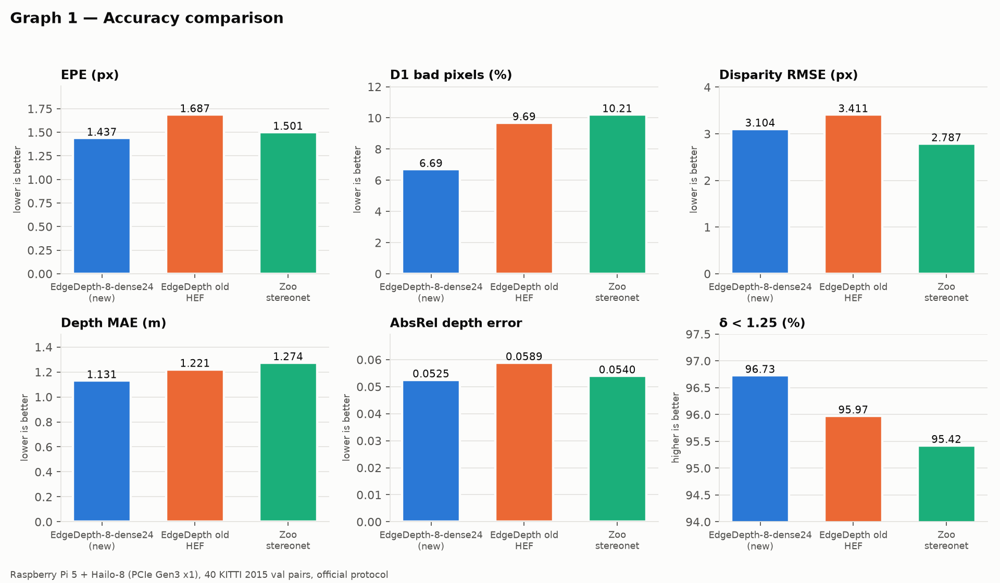
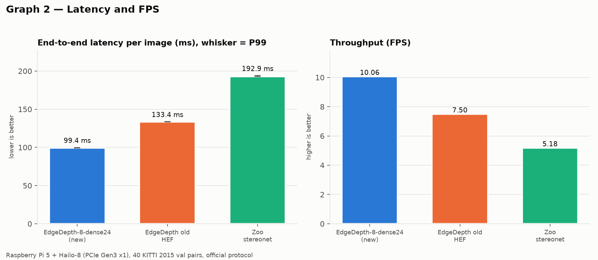
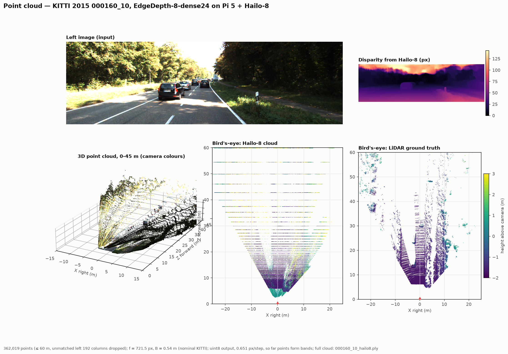

# EdgeDepth-8-dense24

Stereo disparity / depth network for edge deployment on a **Raspberry Pi 5 +
Hailo-8 AI HAT+ (26 TOPS)**. Two rectified RGB images in (368×1232), one
disparity map out; depth = focal × baseline / disparity.

| | |
|---|---|
| Parameters | ~0.91 M |
| Matching | 24 disparity hypotheses at 1/8 resolution, group-wise (8 groups) sub + correlation cost |
| Compute | 17.07 GMAC at 368×1232 |
| HEF | `release/EdgeDepth-8-dense24/hailo8/EdgeDepth-8_hailo8.hef`, 23.16 MB, 7 contexts |
| On the Pi | **1.437 px EPE, D1 6.69%, 10.07 FPS** (KITTI 2015 val, official protocol) |

---

## 1 · Results

All numbers are on the same 40 KITTI 2015 validation pairs. *Official* scores
every pixel with ground truth; *masked* excludes the unmatchable left border.

### Computer → emulator → Pi

| Stage | Where | EPE official | D1 official | EPE masked | D1 masked |
|---|---|---|---|---|---|
| Float (PyTorch / ONNX) | laptop, RTX 4060 | **1.067 px** | 5.06% | 0.987 px | 4.53% |
| int8, Hailo emulator | laptop, DFC 3.34 | 1.329 px | 6.32% | 1.240 px | 5.68% |
| int8, Hailo-8 hardware | Pi 5 + Hailo-8, HailoRT 4.23.0 | **1.437 px** | 6.69% | 1.372 px | 6.17% |

The ONNX export matches PyTorch to 6.0e-4 px. Quantization costs +0.26 px;
the device adds a further +0.11 px over emulation, mostly because the HEF
outputs uint8 disparity (241 levels of 0.651 px).

### On the Pi, against the alternatives

Raspberry Pi 5, Hailo-8 on PCIe Gen3 x1, 200-frame benchmark, batch 1.

| Model | EPE | D1 | Depth MAE | AbsRel | δ<1.25 | Latency | FPS |
|---|---|---|---|---|---|---|---|
| **EdgeDepth-8-dense24** | **1.437 px** | **6.69%** | **1.131 m** | **0.0525** | **96.73%** | **99.4 ms** | **10.07** |
| Earlier EdgeDepth HEF | 1.687 px | 9.69% | 1.221 m | 0.0589 | 95.97% | 133.4 ms | 7.50 |
| Hailo Model Zoo `stereonet` | 1.501 px | 10.21% | 1.274 m | 0.0540 | 95.42% | 192.9 ms | 5.19 |




More figures in [`deploy/pi/figures/`](deploy/pi/figures/): error vs.
distance, accuracy vs. latency, resource utilization, latency distribution.

### Accuracy by range (Pi, masked)

| Range | Pixels | EPE | D1 | Depth MAE |
|---|---|---|---|---|
| 0–20 m | 2.68 M | 1.419 px | 6.25% | 0.42 m |
| 20–40 m | 0.50 M | 1.178 px | 6.02% | 2.57 m |
| 40–80 m | 0.17 M | 1.197 px | 5.44% | 7.75 m |

Disparity error is flat with range, so depth error grows with distance². At
40 m one uint8 output step alone is ~2.9 m of depth.

### Point clouds

Hailo-8 output for three KITTI frames, in [`deploy/pi/pointclouds/`](deploy/pi/pointclouds/)
(`.ply` + rendered `.png`).



### Throughput notes

- Device time is 99.0 ms of the 99.4 ms end to end; host send + post-processing is ~1.2 ms.
- Hailo-8 has no DRAM, so the 7 contexts pass ~595 Mbit/frame of
  inter-context tensors through host memory. Throughput is **PCIe-bound**
  (compute units are 22–30% busy). Use `dtparam=pciex1_gen=3` in the Pi's
  `config.txt`; Gen2 roughly halves FPS.
- Resident memory on the Pi during inference: ~208 MiB.

---

## 2 · The model

`src/model.py` (`HailoStereo`), arch `num_disp 24, groups 8, match_ch 32,
cost both, feat_ch 32, n_res 6, agg_ch 64, refine base`:

1. Shared feature extractor to 1/8 resolution.
2. Cost volume over 24 disparities: group-wise difference (`sub`) and
   group-wise correlation (`corr`), concatenated to 384 channels.
3. 2-D aggregation, then soft-argmin with BatchNorm before the softmax.
4. Three refinement stages up to full resolution.

**dense24** (`src/model_dense24.py`) is the same network and the same weights
with the cost volume rewritten so the Hailo-8 compiler can split it into
contexts: one shift of the right features (24 Slice ops instead of 48), one
Sub, one Mul and two dense 1×1 convolutions. It is an exact rewrite (max
difference 6.4e-4 px over the 40 val pairs), not a retrained model; see
[`release/EdgeDepth-8-dense24/MODEL_CARD.md`](release/EdgeDepth-8-dense24/MODEL_CARD.md).

### Training

SceneFlow Driving pretrain → KITTI 2015 + 2012 mixed fine-tune (354 frames,
60 epochs, lr 5e-5, batch 4, crop 320×768, strong augmentation, EMA 0.999,
scale augmentation 1.0–1.5 at p 0.5). Best epoch 58. Training record:
`runs/kft_both_s60/best.json`, `runs/kft_both_s60_train.log`.

---

## 3 · Reproduce

### Data

- **SceneFlow Driving**: `python src/fetch_driving.py --root data/driving` (resumable, ~3.1 GB).
- **KITTI 2015 + 2012**: manual download, [registration required](http://www.cvlibs.net/datasets/kitti/) (CC BY-NC-SA, non-commercial).

### Train and evaluate (computer)

```bash
python src/train.py --dataset sceneflow --root data/driving --epochs 30 --batch 16 --workers 8
python src/train.py --dataset kitti_mixed --root <kitti_root> --init <sceneflow best.pt> --epochs 60 --lr 5e-5
python src/eval_kitti.py --ckpt release/EdgeDepth-8-dense24/EdgeDepth-8-dense24.pt --root <kitti_root>
```

### Build dense24 from a trained checkpoint

```bash
python src/convert_dense24.py --src runs/kft_both_s60/best.pt --out-dir release/EdgeDepth-8-dense24
python -m pytest src/test_dense24.py
```

Writes the `.pt`, the ONNX (opset 14, inputs `left`/`right`, output
`disparity`, fixed 368×1232) and the model card, after checking equivalence.

### Compile to a Hailo-8 HEF (Linux, DFC 3.34)

See [`deploy/README.md`](deploy/README.md) and
[`release/EdgeDepth-8-dense24/hailo8/COMPILE_NOTES.md`](release/EdgeDepth-8-dense24/hailo8/COMPILE_NOTES.md).

### Run on the Pi

See [`deploy/pi/README.md`](deploy/pi/README.md).

---

## Layout

```
release/EdgeDepth-8-dense24/
  EdgeDepth-8-dense24.pt / .onnx    weights + ONNX
  MODEL_CARD.md                     equivalence, op counts, MACs
  hailo8/EdgeDepth-8_hailo8.hef     the Hailo-8 deliverable
  hailo8/emulator_results.json      fp / int8 emulator scores
  hailo8/COMPILE_NOTES.md           exact compile commands and logs
src/
  model.py                          HailoStereo architecture
  model_grouped.py, model_prered.py,
  model_dense.py                    cost-volume rewrites dense24 builds on
  model_dense24.py                  the deployed cost-volume layout
  convert_dense24.py, test_dense24.py
  train.py, data.py, eval_kitti.py, export_onnx.py
  make_calib.py                     KITTI calibration set for the compiler
  pointcloud.py, fetch_driving.py
deploy/
  dfc_flow.py, hailo-py, install_dfc.sh, hailo_stereo.alls
  pi/                               Pi runner, scorer, demos, results, figures
runs/kft_both_s60/                  training record of the shipped weights
```

## Environment

- Training: Ubuntu 22.04, RTX 4060, torch 2.3.0+cu121, numpy < 2.0.
- Compile: Hailo Dataflow Compiler 3.34 (the 5.x line dropped Hailo-8), Linux x86_64 only.
- Pi: Raspberry Pi 5, Hailo-8 AI HAT+, HailoRT 4.23.0, PCIe Gen3.
- Windows checkout: Python 3.11, onnx **1.16.2** (newer versions need `ml_dtypes`, which Application Control blocks).
